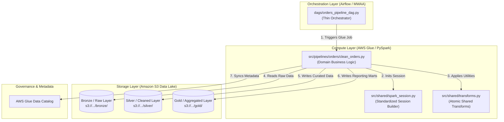
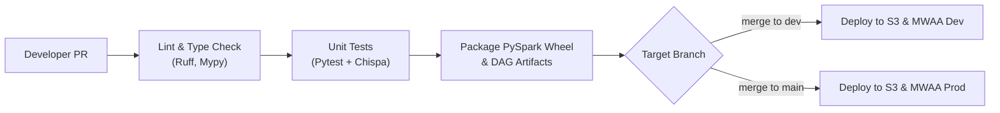

# 🚀 Enterprise AWS Glue & Apache Airflow Data Platform

A production-grade, enterprise data engineering platform blueprint orchestrating serverless **AWS Glue (PySpark)** jobs with **Apache Airflow (Amazon MWAA / Containerized)**. Built with modern software engineering principles including Infrastructure as Code (Terraform), modular PySpark business logic, automated DataFrame testing (Pytest + Chispa), and automated CI/CD pipelines.

---

## 🏛️ Enterprise Repository Architecture

```text
airflow-glue
├── .github/
│   └── workflows/              # CI/CD deployment pipelines
│       ├── deploy-dev.yml
│       └── deploy-prod.yml
├── infra/                      # Infrastructure as Code (Terraform / AWS CDK)
│   ├── modules/                # Reusable Terraform modules (Glue, S3, IAM)
│   └── environments/           # Environment-specific configuration
│       ├── dev.tfvars
│       └── prod.tfvars
├── src/                        # PySpark Business Logic (The Core Code)
│   ├── shared/                 # Reusable utility modules across ALL pipelines
│   │   ├── __init__.py
│   │   ├── spark_session.py    # Standardized Spark session builder
│   │   └── transforms.py       # Common cleaning functions (trim, uppercase, etc.)
│   └── pipelines/              # Pipeline-specific business logic packages
│       ├── orders/
│       │   ├── __init__.py
│       │   ├── clean_orders.py # Modular transformation class
│       │   └── aggregate.py
│       └── customers/
│           ├── __init__.py
│           └── clean_customers.py
├── dags/                       # Apache Airflow (MWAA) Orchestration Layer
│   ├── orders_pipeline_dag.py  # Thin DAG for orders
│   └── customers_pipeline_dag.py # Thin DAG for customers
├── tests/                      # Automated Test Suite (Pytest + Chispa)
│   ├── unit/
│   │   ├── test_orders_transforms.py
│   │   └── test_customer_transforms.py
│   └── integration/
├── pyproject.toml              # Python project & dependency configuration
├── requirements.txt            # Airflow worker dependencies (MWAA)
└── README.md
```

---

## 📐 Architecture Design Principles

### 1. Separation of Concerns (Compute vs. Orchestration)
* **Airflow as Orchestrator**: Airflow DAGs (`dags/`) act purely as workflow schedulers and state machines. They contain **zero business logic** and trigger compute remotely via the `GlueJobOperator` or local Livy REST API.
* **Glue as Compute Engine**: Heavy data transformation, distributed joins, and aggregations run exclusively on serverless AWS Glue PySpark workers, preventing memory starvation or task queue blocking on Airflow workers.

### 2. Domain-Driven Pipeline Design (`src/pipelines/`)
Rather than maintaining monolithic PySpark scripts, processing logic is organized by business domain (e.g., `orders`, `customers`):
* **Modular Transformation Classes**: Transformations inherit or utilize shared transformation methods and execute step-by-step with clean DataFrame inputs and outputs.
* **Packaging & Reusability**: Pipeline code and shared utilities are packaged as standard Python packages or `.whl` / `.zip` artifacts deployed directly to S3 for Glue job execution.

### 3. Reusable Shared Foundation (`src/shared/`)
* **Standardized Spark Session Builder (`spark_session.py`)**: Centralizes Spark configuration (e.g., Delta Lake extensions, Iceberg catalog configs, adaptive query execution, serialization) across local dev, CI/CD runners, and AWS Glue.
* **Atomic Transformations (`transforms.py`)**: Reusable, pure-function PySpark transformations (null handling, whitespace stripping, standard date parsing, masking PII) that are unit-tested once and reused across all pipeline domains.

### 4. Infrastructure as Code (IaC) (`infra/`)
* **Terraform Modules (`infra/modules/`)**: Standardized modules for provisioning AWS Glue Jobs, Glue Data Catalogs, S3 Data Lake buckets (Bronze / Silver / Gold), IAM least-privilege roles, and CloudWatch alerts.
* **Environment Parity (`infra/environments/`)**: Strict separation between environments (`dev.tfvars`, `prod.tfvars`) ensuring zero code drift between staging and production.

### 5. Shift-Left Testing & Quality Gates (`tests/`)
* **Unit Testing (`tests/unit/`)**: Pytest coupled with [Chispa](https://github.com/MrPowers/chispa) for fast, deterministic DataFrame equality assertions locally and in GitHub Actions without provisioning AWS infrastructure.
* **Integration Testing (`tests/integration/`)**: End-to-end integration tests verifying cross-pipeline workflows against test datasets.

---

## 📌 Architecture Data Flow



---

## 🛠️ Local Development & Container Setup

To enable rapid iteration without incurring AWS cloud costs or waiting on remote job queues, the project includes a localized Docker development environment.

### Prerequisites
1. **Docker Desktop**: With WSL2 backend enabled (Windows). Recommended: **8+ GB RAM, 4+ CPUs**.
2. **AWS CLI**: Configured with a local profile:
   ```bash
   aws configure --profile giduturi-tutorial-profile
   ```
3. **Python 3.10+ & `uv`**:
   ```bash
   pip install uv
   uv venv
   .venv\Scripts\activate   # Windows
   # source .venv/bin/activate  # macOS/Linux
   ```

---

### Step 1: Create Shared Docker Network
Airflow and Glue communicate over a dedicated external bridge network:
```bash
docker network create data-network
```

---

### Step 2: Launch AWS Glue Local Environment
```bash
cd docker/glue
docker compose up -d
```
* **JupyterLab Web UI**: [http://localhost:8888/lab](http://localhost:8888/lab)
* **Live Spark UI**: [http://localhost:4040](http://localhost:4040)
* **Spark History Server**: [http://localhost:18080](http://localhost:18080)
* **Livy REST Server**: `http://localhost:8998`

#### Running PySpark Jobs from Local Terminal:
```bash
docker exec -it local-glue bash -l -c "spark-submit /home/glue_user/workspace/jobs/clean_orders_job.py \
    --JOB_NAME clean_orders_job \
    --process_date 2026-10-24 \
    --bucket aws-airflow-data-project-1"
```

---

### Step 3: Launch Apache Airflow Cluster
```bash
cd docker/airflow
docker compose up -d
```
* **Airflow Web UI**: [http://localhost:8080](http://localhost:8080)
  * Default Credentials: `airflow` / `airflow`
* **Health Check**: [http://localhost:8080/api/v2/monitor/health](http://localhost:8080/api/v2/monitor/health)

---

## 🚀 CI/CD & Deployment Strategy



1. **Pull Request Validation**: Runs automated linting (`ruff`), type checking (`mypy`), and unit tests (`pytest tests/unit/`) using GitHub Actions.
2. **Artifact Packaging**: Packages `src/` into a Python wheel/zip file using `pyproject.toml` and syncs it to the S3 scripts bucket (`s3://<bucket>/artifacts/`).
3. **DAG Sync**: Synchronizes `dags/` directly to the MWAA DAGs S3 bucket or triggers MWAA sync mechanisms.
4. **Terraform Apply**: Runs `terraform plan` / `apply` using the designated environment config (`dev.tfvars` or `prod.tfvars`).

---

## 🧪 Testing Strategy

Run unit tests locally using Pytest and Chispa:
```bash
# Run all unit tests
pytest tests/unit/ -v

# Run with coverage report
pytest tests/unit/ --cov=src --cov-report=term-missing
```

Example DataFrame test with Chispa:
```python
from chispa.dataframe_comparer import assert_df_equality
from src.shared.transforms import clean_text_columns

def test_clean_text_columns(spark):
    source_df = spark.createDataFrame(
        [("  alice ", " NY ")], ["name", "state"]
    )
    expected_df = spark.createDataFrame(
        [("alice", "NY")], ["name", "state"]
    )
    actual_df = clean_text_columns(source_df, ["name", "state"])
    assert_df_equality(actual_df, expected_df)
```

---

## 🛑 Teardown & Maintenance

Stop all local services when development is complete:
```bash
# Stop Glue container
cd docker/glue && docker compose down

# Stop Airflow cluster
cd docker/airflow && docker compose down

# Clean all volumes (fresh restart)
docker compose down -v
```
