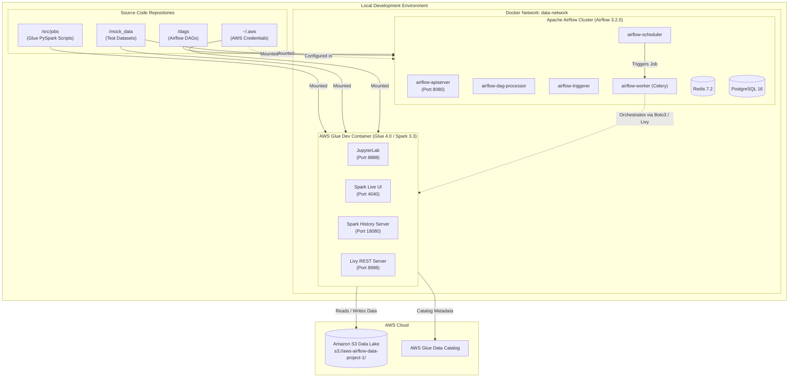

# 🚀 AWS Glue & Apache Airflow Data Engineering Project

A modern, containerized local development environment for building, testing, and orchestrating serverless AWS Glue ETL jobs with Apache Airflow.

---

## 📌 Architecture Overview



---

## ❓ Why Are AWS Glue and Apache Airflow Separated?

A fundamental best practice in enterprise data engineering is **separating orchestration from computation**:

| Aspect | Apache Airflow | AWS Glue (PySpark) |
| :--- | :--- | :--- |
| **Primary Role** | **Workflow Orchestrator** | **Distributed Compute Engine** |
| **Responsibility** | Manages DAG execution order, retries, SLAs, dependencies, backfills, alerts | Executes heavy data transformations, distributed joins, schema conversions |
| **Resource Profile** | Lightweight CPU & memory footprint (triggers API calls, waits on sensors) | Heavy, horizontally scalable compute (multi-node distributed Spark memory) |
| **Local Container** | Standard Python / Celery runtime with Postgres & Redis | Specialized Amazon Linux runtime with Java, Spark, Hadoop, and Glue libraries |

### Key Reasons for Separation:

1. **Orchestration vs. Computation (Compute Decoupling)**:
   - Airflow workers are designed to coordinate tasks, not crunch gigabytes of data. Running heavy PySpark transformations inside an Airflow worker can exhaust its memory, crash the scheduler, and starve other tasks in your organization.
   - Airflow simply triggers the job and monitors its progress (via operators or sensors), consuming negligible resources.

2. **Mirroring Real-World Cloud Production**:
   - In production on AWS, **Airflow** runs as a managed service (Amazon MWAA) or on Amazon ECS/EKS, while **AWS Glue** is completely serverless.
   - Separating them locally into two docker-compose setups connected via a shared bridge network (`data-network`) gives you 1:1 parity with AWS production architecture.

3. **Isolated Environments & Fast Development**:
   - **Glue-Only Iteration**: When writing PySpark scripts, you only need to run the Glue container. You get instant access to JupyterLab (`http://localhost:8888`) without waiting for Airflow's 7 cluster containers to start.
   - **Airflow-Only Iteration**: When building workflow dependencies, scheduling, and alerting, you don't need the heavy 4GB+ Glue Spark image consuming machine resources.

4. **Dependency Segregation**:
   - The AWS Glue Docker image bundles Amazon Linux, Java, Hadoop, Hive, Spark, and custom Glue binaries.
   - Airflow uses Python 3 with database drivers and Airflow providers. Bundling both together would result in a massive, fragile container with conflicting dependencies.

---

## 📁 Project Directory Structure

```text
airflow-glue-project_1/
├── dags/                          # Airflow DAG definition files
├── mock_data/                     # Local test datasets (CSV, JSON, Parquet)
├── src/
│   └── jobs/                      # AWS Glue PySpark ETL scripts
│       └── test_file_1.py         # Sample Glue script writing to S3
├── docker/
│   ├── airflow/                   # Airflow Docker Compose & configuration
│   │   ├── docker-compose.yaml    # Airflow cluster (Celery, Redis, Postgres)
│   │   ├── .env                   # Airflow environment variables
│   │   ├── Dockerfile             # Custom Airflow image (optional)
│   │   ├── config/                # Airflow configuration files
│   │   ├── logs/                  # Execution logs
│   │   └── plugins/               # Custom Airflow plugins
│   └── glue/                      # AWS Glue Docker Compose & configuration
│       └── docker-compose.yml     # Glue 4.0 runtime container
└── README.md                      # Project documentation
```

---

## 🛠️ Prerequisites

Before getting started, make sure you have:

1. **Docker Desktop**:
   - Installed with WSL2 backend enabled (on Windows).
   - Recommended Docker resources: **At least 8 GB RAM and 4 CPUs** (since Glue and Airflow both run in Docker).
2. **AWS CLI**:
   - Configured locally with your credentials:
     ```bash
     aws configure --profile giduturi-tutorial-profile
     ```
   - This creates `~/.aws/credentials` and `~/.aws/config`, which the Glue container mounts directly to authenticate with AWS (S3, Glue Catalog).
3. **Python 3.10+ & `uv`** (Optional, for local IDE code completion/linting):
   ```powershell
   pip install uv
   uv venv
   .venv\Scripts\activate
   ```

---

## 🚀 Setup & Execution Guide

### Step 1: Create the Shared Docker Network

Both Airflow and Glue communicate over a dedicated external Docker network called `data-network`. Create it once:

```bash
docker network create data-network
```

---

### Step 2: Start the AWS Glue Development Environment

Navigate to the Glue docker directory:

```bash
cd docker/glue
docker compose up -d
```

#### What this does:
- Starts `local-glue` running `amazon/aws-glue-libs:glue_libs_4.0.0_image_01`.
- Mounts `src/jobs` to `/home/glue_user/workspace/jobs`.
- Mounts `mock_data` to `/home/glue_user/workspace/mock_data`.
- Mounts `~/.aws` to `/home/glue_user/.aws:ro` for AWS credentials.
- Starts JupyterLab and the Livy server.

#### Accessible UIs:
- **JupyterLab Web UI**: [http://localhost:8888/lab](http://localhost:8888/lab) (token and password are disabled for local dev).
- **Live Spark UI**: [http://localhost:4040](http://localhost:4040) (active while jobs are running).
- **Spark History Server**: [http://localhost:18080](http://localhost:18080) (history of all completed jobs).

#### Running a Glue Job Manually inside the Container:
```bash
docker exec -it local-glue bash
# Inside the container:
gluesparksubmit /home/glue_user/workspace/jobs/test_file_1.py
```
Or directly from your host terminal:
```bash
docker exec -it local-glue gluesparksubmit /home/glue_user/workspace/jobs/test_file_1.py
```

---

### Step 3: Start the Apache Airflow Cluster

Open another terminal and navigate to the Airflow docker directory:

```bash
cd docker/airflow
```

Ensure your `docker/airflow/.env` has the necessary settings:
```ini
AIRFLOW_IMAGE_NAME=apache/airflow:3.2.0
AIRFLOW_UID=50000
FERNET_KEY=Cgw7p7CRJjaF2frNYQW6UCtNHU7M2HLl50Xnl53pP5U=
_AIRFLOW_WWW_USER_USERNAME=airflow
_AIRFLOW_WWW_USER_PASSWORD=airflow
_PIP_ADDITIONAL_REQUIREMENTS=apache-airflow-providers-amazon
```

Start the Airflow cluster:
```bash
docker compose up -d
```

#### What this does:
- Runs database migrations via `airflow-init` and creates the default `Admin` user (`airflow`).
- Starts PostgreSQL 16 and Redis 7.2.
- Starts the `airflow-apiserver`, `airflow-scheduler`, `airflow-dag-processor`, `airflow-triggerer`, and Celery `airflow-worker`.
- Mounts `dags/` to `/opt/airflow/dags`.
- Mounts `mock_data/` to `/opt/airflow/mock_data`.
- Connects to both `airflow_default` and `data-network`.

#### Accessible UIs:
- **Airflow Web UI**: [http://localhost:8080](http://localhost:8080)
  - **Username**: `airflow`
  - **Password**: `airflow`
- **Health Check Endpoint**: [http://localhost:8080/api/v2/monitor/health](http://localhost:8080/api/v2/monitor/health)

---

## 🔄 Connecting Airflow to Glue

You have two primary ways to orchestrate Glue jobs from Airflow:

### Option A: Local Development via Livy REST API (No AWS Charges)
Because both containers are on `data-network`, the Airflow worker can submit Spark code directly to the local Glue container using Livy:
- **Livy URL**: `http://local-glue:8998`
- Can be triggered using Airflow's `LivyOperator` or `SimpleHttpOperator`.

### Option B: AWS Cloud Glue Jobs (Production Simulation)
Using Airflow's native `GlueJobOperator`:
```python
from airflow import DAG
from airflow.providers.amazon.aws.operators.glue import GlueJobOperator
from datetime import datetime

with DAG(
    dag_id="orchestrate_glue_job",
    start_date=datetime(2026, 1, 1),
    schedule=None,
    catchup=False,
) as dag:

    submit_glue = GlueJobOperator(
        task_id="submit_glue_task",
        job_name="my_production_glue_job",
        script_location="s3://aws-airflow-data-project-1/scripts/test_file_1.py",
        aws_conn_id="aws_default",
        region_name="ap-south-1",
    )
```

---

## 🛑 Stopping the Services

To stop containers when you are done working:

### Stop Glue:
```bash
cd docker/glue
docker compose down
```

### Stop Airflow:
```bash
cd docker/airflow
docker compose down
```

To stop and remove database volumes (fresh start):
```bash
docker compose down -v
```

---

## 🛠️ Common Troubleshooting

### 1. `undefined network data-network`
If `docker compose up` complains about `data-network`, run:
```bash
docker network create data-network
```

### 2. S3 Access Denied when running Glue jobs
Ensure the profile in [docker/glue/docker-compose.yml](file:///d:/AWS/airflow-glue-project_1/docker/glue/docker-compose.yml#L13) matches your profile in `~/.aws/credentials`:
```yaml
environment:
  - AWS_DEFAULT_REGION=ap-south-1
  - AWS_PROFILE=giduturi-tutorial-profile
```
And verify your IAM user/role has `s3:PutObject`, `s3:GetObject`, and `s3:ListBucket` permissions on `s3://aws-airflow-data-project-1/`.

### 3. Port Conflicts
- Port `8080`: Used by Airflow API Server / Web UI.
- Port `8888`: Used by Glue JupyterLab.
- Port `5432`: Used by Airflow PostgreSQL.
If any port is already in use by local services, change the host port in the respective `docker-compose.yaml` (e.g., `"8081:8080"`).
